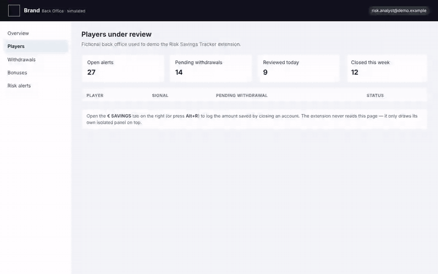
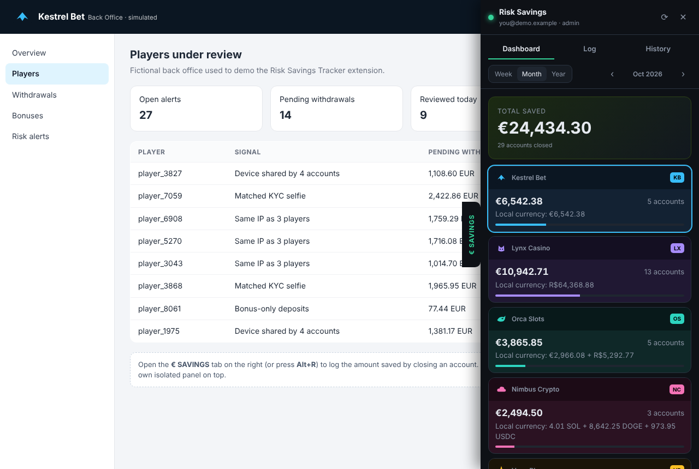
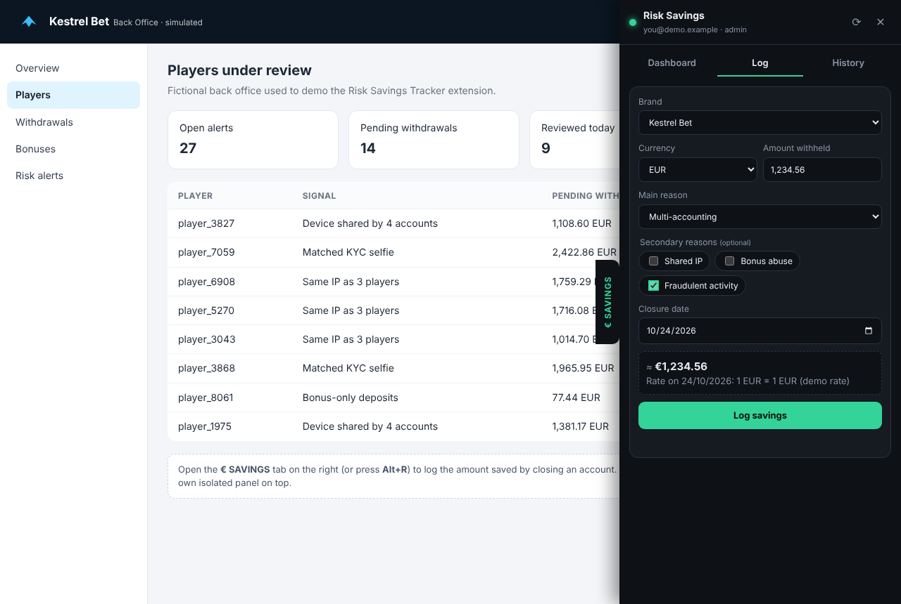
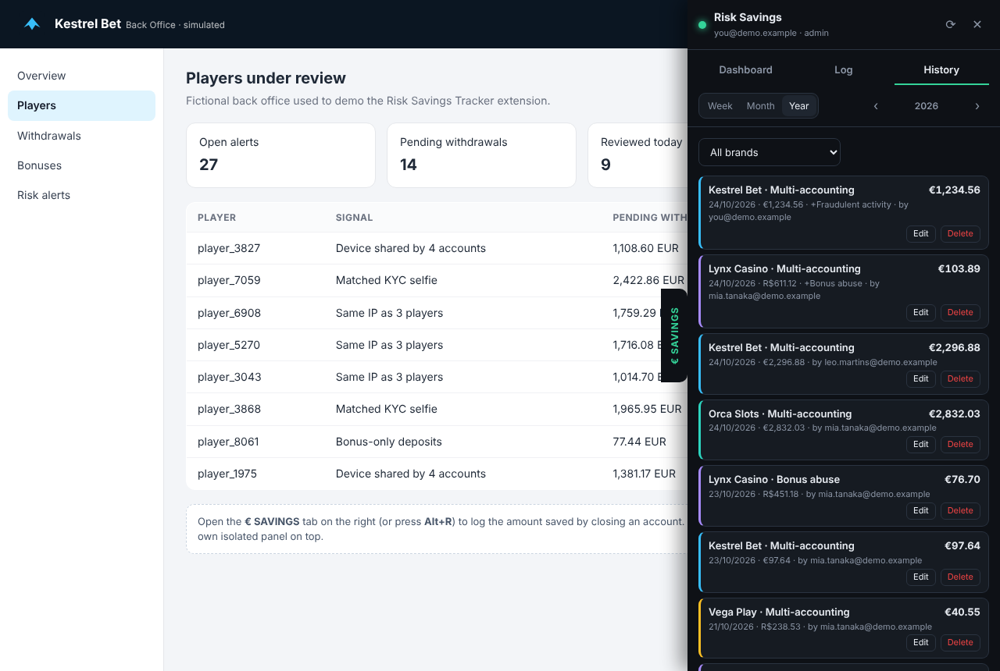

# Risk Savings Tracker

**A Chrome extension that shows how much money a risk & fraud team saves by closing abusive accounts — in euros, per brand, per week, month and year.**

> Portfolio version of an internal tool I built for a multi-brand iGaming risk team.
> **All brands, back offices, people and numbers in this repository are fictional.**



▶ **[Watch the full demo (MP4)](media/demo.mp4)** · 🌐 **[Live demo](https://jessicagpw.github.io/risk-savings-tracker/)** (runs in the browser, no install)

---

## The problem

The risk team closes accounts for multi-accounting, shared IPs, bonus abuse and fraud across several brands, each with its own back office (run by different vendors) and its own currencies — EUR, BRL and 10 crypto assets. The money withheld on each closure was tracked by hand in a spreadsheet, so nobody could answer a simple question quickly: **how much did the team save this month, and where?**

## The solution

A side drawer that appears on top of every brand's back office:

| | |
|---|---|
| **Dashboard** | Total saved in EUR, one card per brand (the brand you are on is highlighted), amounts in local currency, closure reasons ranked by number of accounts or by value. Week / month / year totals and currency conversion. |
| **Log** | Brand pre-selected from the back office you are on. Amount + currency + main reason + optional secondary reasons. Converts to EUR with the rate of the day (ECB via Frankfurter, CoinGecko via REST). |
| **History** | Filter by brand. Admins can edit or soft-delete; nothing is ever hard-deleted (audit trail). |
| **Reports** | One-click CSV per period, plus an hourly mirror to Google Sheets for finance. |

| Dashboard | Log | History |
|---|---|---|
|  |  |  |

## Design decisions

- **No integration with vendor back offices.** The extension never reads or changes the host page: it only injects an isolated iframe inside a closed Shadow DOM. Zero risk for third-party systems.
- **Privacy by design.** No player data is stored — only brand, reasons, amount, currency, rate, EUR value, date and operator.
- **Zero dependencies.** Plain JavaScript modules, Manifest V3, Firebase used over its **REST APIs** (no SDK, no bundler). The whole extension is ~70 KB, icons included.
- **Security in the backend, not the client.** Firestore rules enforce: company-domain verified e-mails only, schema validation of every field, author and server timestamps that cannot be forged, and only the right team can edit records.
- **Cheap to run.** Incremental sync (`updatedAt > lastSync`) and a local cache keep reads far below the Firebase free tier.
- **Demo mode in the same codebase.** `CONFIG.MODE = 'demo'` swaps the Firestore adapter for a local adapter with deterministic fictional data — used for tests, this portfolio and the live demo.

## Architecture

```text
 Brand back office (any vendor)            Chrome extension (MV3)
 ┌───────────────────────────┐   inject   ┌──────────────────────────────┐
 │  page (never read)        │ ─────────► │ content.js → closed Shadow   │
 │                           │            │ DOM → iframe(panel.html)     │
 └───────────────────────────┘            │  panel.js  (UI)              │
                                           │  data.js   (cache + sync)    │
                                           │   ├─ firestore.js (REST)     │
                                           │   └─ demo.js (fictional)     │
                                           │  fx.js  (ECB / CoinGecko)    │
                                           │  auth.js + background.js     │
                                           └──────────────┬───────────────┘
                                                          │ Google sign-in → Firebase Auth
                                                          ▼
                                    Firestore (security rules)  ──► Apps Script ──► Google Sheets
```

## Run it locally (demo mode, ~1 minute)

Requirements: Node 18+ and Google Chrome.

```bash
git clone https://github.com/JessicaGPW/risk-savings-tracker.git
cd risk-savings-tracker
npm run demo          # zero-dependency static server on :8080
```

1. Open `chrome://extensions`, enable **Developer mode**, click **Load unpacked** and select the `extension/` folder.
2. Open a simulated back office: <http://kestrel.localhost:8080/demo-site/> (also `lynx`, `orca`, `vega`, `nimbus`).
3. Click the **€ SAVINGS** tab on the right, or press **Alt+R**.

## Live demo

The `demo-site/` page falls back to drawing the same drawer when the extension is not installed, so the whole demo also runs as a static site. It is served by GitHub Pages straight from the `main` branch.

## Tests

```bash
npm install            # installs Playwright (dev only)
npx playwright install chromium
npm test               # E2E: loads the extension, checks dashboard, logging, history, crypto
npm run record         # re-records media/demo.webm with cursor and captions
```

## Production setup

See [docs/SETUP.md](docs/SETUP.md): Firebase project (Spark plan), Firestore rules, Google sign-in, OAuth client and the Google Sheets mirror. Fill `extension/src/config.js` locally and **never commit secrets**.

## Tech

Chrome Extensions MV3 · JavaScript (ES modules) · Firebase Auth & Firestore (REST) · Firestore Security Rules · Google Apps Script · Frankfurter (ECB) & CoinGecko APIs · Playwright

---

## 🇧🇷 Em português

**Extensão do Chrome que mostra quanto o time de risco economiza ao encerrar contas por fraude e abuso — em euro, por marca, por semana, mês e ano.**

Versão de portfólio de uma ferramenta interna que desenvolvi para o time de risco de um grupo de iGaming com várias marcas. **Marcas, backoffices, pessoas e valores deste repositório são fictícios.**

- **Problema:** cada marca tem seu backoffice (de fornecedores diferentes) e suas moedas (EUR, BRL e 10 criptomoedas). O valor retido em cada encerramento era controlado à mão numa planilha, e ninguém conseguia responder rapidamente: quanto o time economizou este mês e em qual marca?
- **Solução:** uma gaveta lateral que aparece por cima de qualquer backoffice, com painel por marca, lançamento com conversão automática para euro (cotação do dia, congelada no lançamento), histórico e relatórios para o financeiro.
- **Decisões:** nenhuma integração com os sistemas dos fornecedores (a extensão não lê a página), nenhum dado de jogador, zero dependências, Firebase via REST, segurança garantida pelas regras do Firestore, e modo demo com dados fictícios.

**Para rodar:** `npm run demo`, carregue a pasta `extension/` em `chrome://extensions` (modo desenvolvedor) e abra <http://kestrel.localhost:8080/demo-site/>.

## Aviso de direitos autorais

© 2026 Jessica Baptista. Todos os direitos reservados.

É proibida a cópia, reprodução, distribuição, modificação ou uso deste repositório sem autorização prévia por escrito da autora.

## License

[MIT](LICENSE)
